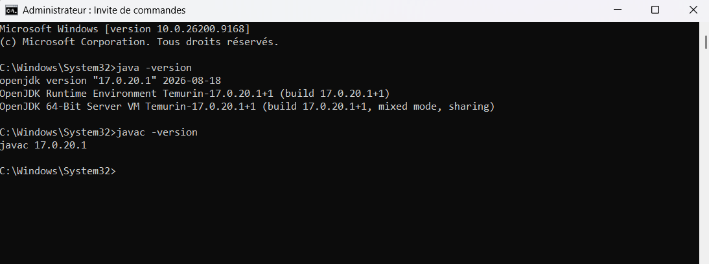
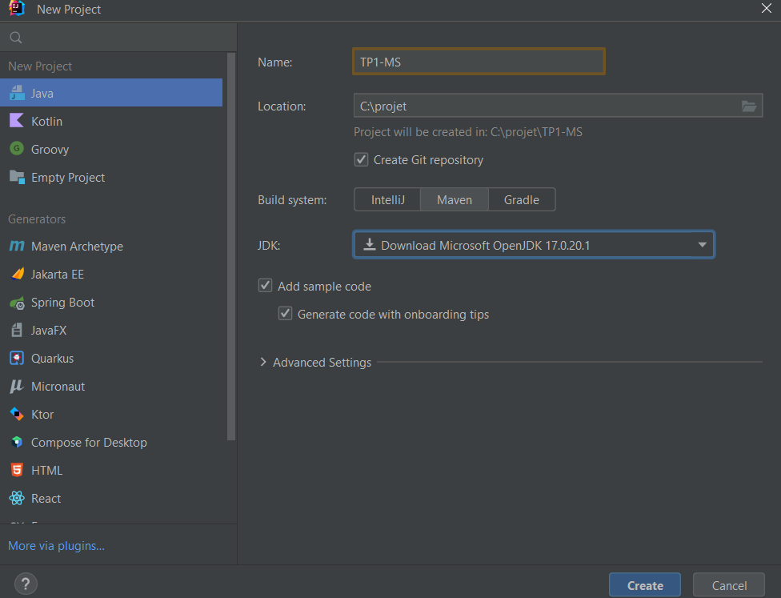
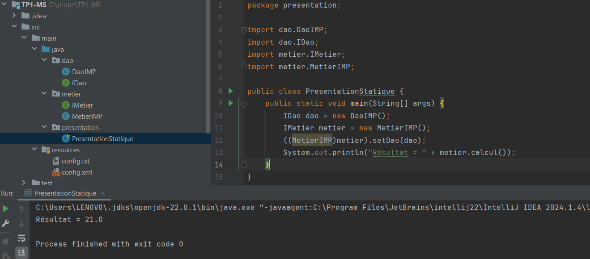
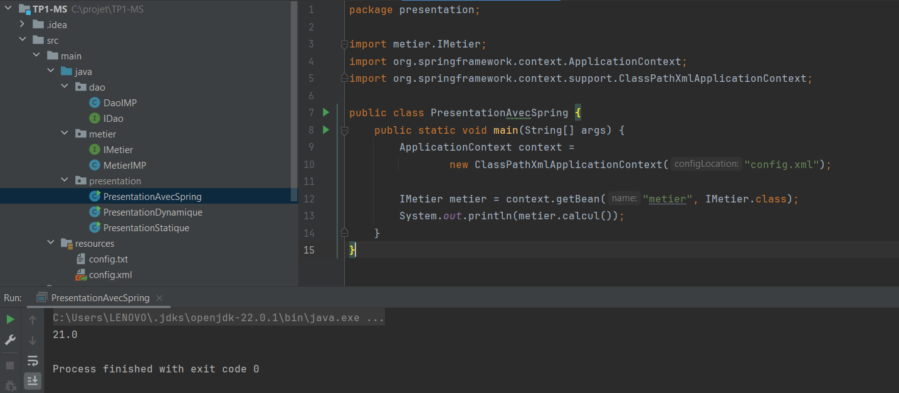

# TP1 — Inversion de Contrôle et Injection de Dépendances

## 1. Présentation du TP

### Objectifs généraux

Ce TP a pour objectif de comprendre les concepts d'injection de dépendances (*Dependency Injection — DI*) et d'inversion de contrôle (*Inversion of Control — IoC*), ainsi que l'utilisation d'un fichier de configuration XML.

Les objectifs sont les suivants :

- Comprendre le principe de l'injection de dépendances.
- Comprendre le principe de l'inversion de contrôle.
- Découvrir le couplage faible entre les composants d'une application.
- Utiliser la réflexion Java pour créer des objets dynamiquement.
- Découvrir le conteneur IoC du framework Spring.
- Configurer les dépendances avec XML et avec les annotations Spring.

### Environnement de développement

- **Langage :** Java
- **JDK :** 17
- **IDE :** IntelliJ IDEA
- **Gestion du projet :** Maven
- **Framework :** Spring Framework
- **Configuration :** fichier `config.txt`, fichier `config.xml` et annotations

### Présentation de l'application

L'application est organisée en trois packages :

- `dao` : contient l'interface `IDao` et son implémentation `DaoIMP`.
- `metier` : contient l'interface `IMetier` et son implémentation `MetierIMP`.
- `presentation` : contient les classes permettant d'exécuter l'application.

La couche métier dépend de l'interface `IDao` pour récupérer une valeur. La méthode `calcul()` multiplie cette valeur par 7.

Dans notre implémentation, `DaoIMP.getValue()` retourne `3`. Le résultat attendu est donc :

**Résultat attendu :** `3 × 7 = 21.0`

---

### 2. Vérification du JDK

Avant de commencer le TP, nous avons vérifié l’installation et la configuration du **JDK 17** dans PowerShell en exécutant les commandes suivantes :

```powershell
java -version
javac -version
```

- `java -version` permet de vérifier la version de l’environnement d’exécution Java.
- `javac -version` permet de vérifier la version du compilateur Java.

Les deux commandes affichent la version **17.0.20.1**. Nous avons également vérifié que la variable d’environnement `JAVA_HOME` pointe vers le répertoire d’installation du JDK.

Cette vérification confirme que l’environnement Java nécessaire à la réalisation du TP est correctement configuré.



*Figure 1 : Vérification des versions de Java et du compilateur, ainsi que de la variable `JAVA_HOME` dans PowerShell.*

---

### 3. Création du projet Maven

Le projet **TP1-MS** a été créé avec **IntelliJ IDEA**, en utilisant Maven comme système de gestion et de construction du projet.

Les étapes de création sont les suivantes :

1. Sélectionner **New Project** dans IntelliJ IDEA.
2. Choisir **Java** comme langage de programmation.
3. Sélectionner **Maven** comme système de build.
4. Choisir **JDK 17** comme version du JDK.
5. Définir le nom du projet : `TP1-MS`.
6. Renseigner les paramètres du projet :
   - **GroupId :** `org.example`
   - **ArtifactId :** `TP1`

Cette configuration permet de créer un projet Maven prêt à accueillir les différentes classes Java nécessaires aux activités du TP.



*Figure 2 : Création du projet Maven `TP1-MS` dans IntelliJ IDEA avec JDK 17, GroupId `org.example` et ArtifactId `TP1`.*

## 2. Activité 1-1 — Injection de dépendances par instanciation statique

### 2.1. Objectif

L’objectif de cette activité est de comprendre le principe de l’injection de dépendances (*Dependency Injection*) et de découvrir comment le couplage faible peut être mis en œuvre en Java.

### 2.2. Implémentation

Pour réaliser cette activité, nous avons créé cinq éléments répartis dans trois packages : `dao`, `metier` et `presentation`.

#### Étape 1 : Création de l’interface `IDao` (package `dao`)

L’interface `IDao` définit la méthode `getValue()`, qui permet de récupérer une valeur depuis la couche d’accès aux données.

```java
package dao;

public interface IDao {
    double getValue();
}
```

#### Étape 2 : Création de la classe `DaoIMP` (package `dao`)

La classe `DaoIMP` implémente l’interface `IDao`. Sa méthode `getValue()` retourne la valeur `3`, simulant ainsi un accès aux données.

```java
package dao;

public class DaoIMP implements IDao {

    @Override
    public double getValue() {
        return 3; // Simulation d'un accès aux données
    }
}
```

#### Étape 3 : Création de l’interface `IMetier` (package `metier`)

L’interface `IMetier` définit la méthode `calcul()`, chargée d’effectuer le traitement métier.

```java
package metier;

public interface IMetier {
    double calcul();
}
```

#### Étape 4 : Création de la classe `MetierIMP` (package `metier`)

La classe `MetierIMP` implémente l’interface `IMetier`. Elle possède une référence de type `IDao`, utilisée pour récupérer la valeur nécessaire au calcul.

La méthode `setDao()` permet d’injecter la dépendance, tandis que la méthode `calcul()` multiplie la valeur récupérée par `7`.

```java
package metier;

import dao.IDao;

public class MetierIMP implements IMetier {

    private IDao dao;

    @Override
    public double calcul() {
        return dao.getValue() * 7;
    }

    public void setDao(IDao dao) {
        this.dao = dao;
    }
}
```

#### Étape 5 : Création de la classe `PresentationStatique` (package `presentation`)

La classe `PresentationStatique` constitue le point d’entrée de l’application. Elle crée les objets DAO et métier à l’aide de `new`, injecte la dépendance avec `setDao()`, puis affiche le résultat du calcul.

```java
package presentation;

import dao.DaoIMP;
import metier.MetierIMP;

public class PresentationStatique {

    public static void main(String[] args) {

        DaoIMP dao = new DaoIMP();

        MetierIMP metier = new MetierIMP();
        metier.setDao(dao);

        System.out.println("Résultat = " + metier.calcul());
    }
}
```

### 2.3. Comment cette solution illustre-t-elle le couplage faible ?

Le couplage faible est obtenu grâce à l’utilisation de l’interface `IDao`.

La classe `MetierIMP` dépend de l’interface `IDao` et non directement de la classe concrète `DaoIMP`. Il est donc possible de remplacer `DaoIMP` par une autre implémentation de `IDao` sans modifier la logique métier, à condition de respecter le même contrat.

Cependant, la classe `PresentationStatique` reste responsable de la création des objets et du choix de l’implémentation utilisée.

### 2.4. Le principe d’Inversion de Contrôle est-il respecté ?

Le principe d’Inversion de Contrôle (*IoC*) est partiellement appliqué.

L’injection de dépendances permet de fournir la dépendance DAO à la classe métier depuis l’extérieur. Toutefois, la classe `PresentationStatique` conserve le contrôle de la création des objets grâce aux instructions `new`.

La création et l’assemblage des objets ne sont donc pas confiés à un conteneur IoC externe.

### 2.5. Que faudrait-il modifier pour éviter que la présentation contrôle directement la création des objets ?

Il faudrait externaliser davantage la configuration et la création des objets.

Plusieurs solutions sont possibles :

- Lire les noms des classes depuis un fichier de configuration et utiliser la réflexion Java.
- Utiliser un conteneur IoC comme celui de Spring pour créer les objets et injecter automatiquement leurs dépendances.

Ces solutions sont étudiées dans les activités suivantes.

### 2.6. Résultat obtenu

Après l’exécution de `PresentationStatique`, le programme affiche le résultat suivant :

```text
Résultat = 21.0
```

Ce résultat correspond au calcul suivant :

**Valeur DAO × 7 = 3 × 7 = 21.0**

### 2.7. Capture d’écran



*Figure 3 : Résultat de l’exécution de la classe `PresentationStatique`.*

---

## 3. Activité 1-2 — Injection de dépendances par instanciation dynamique

### 3.1. Objectif

L'objectif est de réaliser une injection de dépendances par instanciation dynamique à partir des noms de classes définis dans un fichier de configuration.

### 3.2. Configuration

Nous avons créé le fichier `config.txt`, contenant les noms complets des classes à instancier :

```text
dao.DaoIMP
metier.MetierIMP
```

Ce fichier permet de séparer les noms des implémentations du code de la classe de présentation.

### 3.3. Implémentation

Nous avons créé la classe `PresentationDynamique`.

Cette classe effectue les opérations suivantes :

1. Lire les noms des classes depuis `config.txt`.
2. Charger les classes avec la méthode `Class.forName()`.
3. Créer les objets dynamiquement avec la réflexion Java.
4. Injecter l'objet DAO dans l'objet métier à l'aide de la méthode `setDao()`, appelée par réflexion.
5. Exécuter la méthode `calcul()` et afficher le résultat.

### 3.4. Comment cette approche illustre-t-elle l'injection de dépendances dynamique ?

Dans cette approche, les classes concrètes ne sont plus directement instanciées par des instructions telles que `new DaoIMP()` et `new MetierIMP()` dans la classe de présentation.

Les noms des implémentations sont lus depuis `config.txt`, puis les objets sont créés dynamiquement.

L'injection de dépendances est également réalisée par réflexion. La dépendance DAO est donc fournie à l'objet métier depuis l'extérieur.

### 3.5. En quoi cette approche se rapproche-t-elle davantage du principe IoC ?

Par rapport à l'activité 1-1, le choix des implémentations est externalisé dans un fichier de configuration.

Il est possible de remplacer une implémentation par une autre en modifiant le fichier de configuration, sans modifier directement le code de la classe de présentation.

Le contrôle est donc davantage externalisé. Cependant, la classe `PresentationDynamique` reste responsable de la lecture de la configuration, de la création des objets et de l'injection des dépendances.

Il ne s'agit donc pas encore d'une gestion complète par un conteneur IoC.

### 3.6. Quels sont les avantages et les limites de cette solution ?

**Avantages :**

- Les noms des classes sont externalisés dans un fichier de configuration.
- Les implémentations peuvent être remplacées sans modifier directement la classe de présentation.
- La solution permet de comprendre le fonctionnement de la réflexion Java.
- Elle réduit la dépendance de la présentation envers les classes concrètes.

**Limites :**

- Le code de création des objets et d'injection reste à développer manuellement.
- Une erreur dans le nom d'une classe ou dans le fichier de configuration peut provoquer une exception.
- La réflexion rend le code plus difficile à comprendre et à déboguer.
- La maintenance devient plus complexe lorsque le nombre de dépendances augmente.

### 3.7. Résultat obtenu

L'exécution de `PresentationDynamique` affiche :

```text
21.0
```

### 3.8. Captures d'écran

.png)

.png)

---

## 4. Activité 1-3 — Injection de dépendances avec Spring et XML

### 4.1. Objectif

L'objectif est d'utiliser le framework Spring pour gérer les dépendances à partir d'un fichier de configuration XML.

### 4.2. Configuration XML

Nous avons créé le fichier `config.xml` dans le répertoire `src/main/resources`.

Ce fichier définit les deux beans et la relation entre eux :

- Le bean `dao` représente l'implémentation `DaoIMP`.
- Le bean `metier` représente l'implémentation `MetierIMP`.
- La propriété `dao` du bean `metier` référence le bean `dao`.

La dépendance est ainsi configurée à l'extérieur des classes Java.

### 4.3. Configuration Maven

Les dépendances Spring nécessaires ont été ajoutées au fichier `pom.xml` :

- `spring-core`
- `spring-beans`
- `spring-context`

Ces bibliothèques permettent notamment d'utiliser le conteneur Spring, de gérer les beans et de charger le contexte de l'application.

### 4.4. Fonctionnement

Nous avons créé la classe `PresentationAvecSpring`.

Elle charge le contexte Spring à partir de `config.xml`, récupère le bean métier et exécute sa méthode `calcul()`.

Le conteneur Spring se charge de :

1. Lire la configuration XML.
2. Créer les beans déclarés.
3. Injecter la dépendance DAO dans le bean métier.
4. Fournir l'objet métier à la classe de présentation.

La classe de présentation n'a donc plus besoin de créer manuellement les objets DAO et métier.

### 4.5. Comparaison avec l'activité 1-2

Dans l'activité 1-2, nous avons utilisé la réflexion Java pour créer les objets et réaliser l'injection de dépendances. Nous avons dû écrire nous-mêmes le code de lecture de la configuration et d'assemblage des objets.

Dans cette activité, Spring prend en charge ces opérations à travers son conteneur IoC. La configuration XML décrit les objets à créer et leurs relations.

Cette solution facilite la gestion des dépendances et réduit la quantité de code technique à écrire.

### 4.6. Différence entre création manuelle, réflexion et conteneur Spring

**1. Création manuelle des objets**

Le programmeur crée directement les objets avec `new` et associe les dépendances manuellement.

Cette solution est simple, mais la classe de présentation doit connaître les implémentations concrètes.

**2. Création par réflexion avec `Class.forName()`**

Les noms des classes sont lus depuis une configuration, puis les objets sont créés dynamiquement.

Cette solution rend le choix des implémentations plus flexible, mais le programmeur doit toujours gérer la création et l'injection des objets.

**3. Création par le conteneur Spring**

Le conteneur Spring crée les objets, appelés beans, et gère leurs dépendances à partir de la configuration.

La classe de présentation récupère directement le bean dont elle a besoin. La gestion des objets est donc confiée au conteneur.

### 4.7. Résultat obtenu

L'exécution de `PresentationAvecSpring` affiche :

```text
21.0
```

### 4.8. Captures d'écran



.png)

---

## 5. Activité 1-4 — Injection de dépendances avec Spring et annotations

### 5.1. Objectif

L'objectif est de découvrir les annotations Spring permettant de déclarer les composants et de gérer automatiquement l'injection de dépendances.

### 5.2. Annotations utilisées

**`@Repository`**

Cette annotation est utilisée sur la classe `DaoIMP` pour indiquer qu'elle représente un composant de la couche d'accès aux données.

**`@Service`**

Cette annotation est utilisée sur la classe `MetierIMP` pour identifier le composant de la couche métier.

**`@Autowired`**

Cette annotation est utilisée sur la dépendance `IDao` de `MetierIMP`. Elle permet à Spring de rechercher un bean compatible et de l'injecter automatiquement.

### 5.3. Fonctionnement

Nous avons créé la classe `PresentationAvecAnnotation`.

Le contexte Spring est configuré pour scanner les packages `dao` et `metier`.

Spring détecte les classes annotées, crée les beans correspondants et résout leurs dépendances. L'objet métier reçoit automatiquement une implémentation de `IDao`.

La classe de présentation récupère ensuite le bean métier et exécute la méthode `calcul()`.

Il n'est donc plus nécessaire de déclarer les beans et leur relation dans le fichier `config.xml` pour cette configuration par annotations.

### 5.4. Pourquoi cette solution est-elle plus maintenable que la configuration XML ?

L'utilisation des annotations présente plusieurs avantages :

- La configuration est directement associée aux classes concernées.
- Il y a moins de configuration XML à écrire et à maintenir.
- Les composants sont facilement identifiables grâce aux annotations.
- L'injection des dépendances est gérée automatiquement par Spring.
- L'évolution des composants est généralement plus simple lorsque le projet grandit.

Cependant, les annotations ne suppriment pas toute configuration : il faut notamment activer ou configurer le scan des composants et gérer les cas où plusieurs implémentations correspondent à une même interface.

### 5.5. En quoi cette activité représente-t-elle une application complète du principe IoC ?

Dans cette activité, la création des objets et la résolution de leurs dépendances sont confiées au conteneur Spring.

La classe de présentation ne crée pas directement les objets DAO et métier. Elle demande au conteneur l'objet métier dont elle a besoin.

Le conteneur contrôle donc le cycle de création et l'assemblage des composants. La configuration par annotations constitue ici une application du principe IoC avec injection de dépendances gérée par Spring.

### 5.6. Résultat obtenu

L'exécution de `PresentationAvecAnnotation` affiche :

```text
21.0
```

### 5.7. Capture d'écran

.png)

---

## 6. Comparaison des quatre approches

| Approche | Gestion des objets | Gestion des dépendances | Niveau d'externalisation |
|---|---|---|---|
| Instanciation statique | Manuelle avec `new` | Manuelle avec `setDao()` | Faible |
| Instanciation dynamique | Réflexion Java | Réflexion et injection manuelle | Intermédiaire |
| Spring XML | Conteneur Spring | Configuration XML | Élevé |
| Spring annotations | Conteneur Spring | Annotations et scan des composants | Élevé |

### Synthèse

- **Activité 1-1 :** le programmeur contrôle directement la création des objets.
- **Activité 1-2 :** les noms des implémentations sont externalisés, mais la création reste gérée par du code personnalisé.
- **Activité 1-3 :** Spring crée les beans et injecte leurs dépendances à partir du XML.
- **Activité 1-4 :** Spring détecte les composants annotés et gère automatiquement leurs dépendances.

---

## 7. Conclusion générale

Ce TP nous a permis de comprendre progressivement le couplage faible, l'injection de dépendances et le principe d'inversion de contrôle.

La première activité a montré que l'utilisation d'interfaces permet de réduire le couplage entre la couche métier et les implémentations concrètes, même si la création des objets reste manuelle.

La deuxième activité a introduit la réflexion Java et l'externalisation des noms de classes dans un fichier de configuration. Cette solution offre davantage de flexibilité, mais nécessite encore une gestion manuelle de la création et de l'injection des objets.

Les deux dernières activités ont montré comment Spring simplifie cette gestion grâce à son conteneur IoC. La configuration XML permet de déclarer explicitement les beans et leurs dépendances, tandis que les annotations permettent de déclarer les composants directement dans le code.

En conclusion, l'injection de dépendances favorise le couplage faible, facilite le remplacement des implémentations et améliore la maintenabilité des applications. Le conteneur Spring automatise la création des objets et la résolution de leurs dépendances, ce qui réduit le code technique nécessaire à leur gestion.
